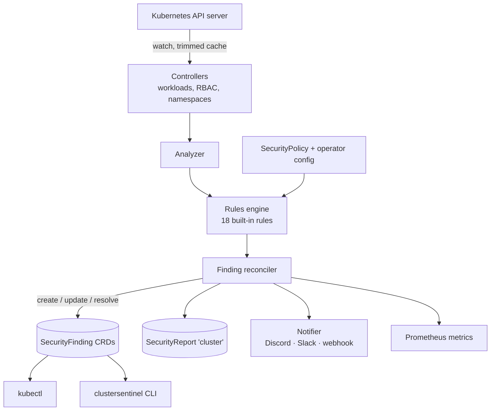

# Implementation plan

This is the working plan for the ClusterSentinel MVP. It records the decisions taken, the
assumptions made where the requirements were ambiguous, and the status of each phase.

## Status

| Phase | Scope | Status |
| --- | --- | --- |
| 1. Bootstrap | Go module, Kubebuilder project, CRD types, manager, Dockerfile, kind workflow, RBAC contract | **Done** |
| 2. Workload scanning | Workload, Pod, RBAC and namespace controllers, the 18 rules, unit and envtest tests | **Done** |
| 3. Findings | Finding reconciliation, deduplication, resolution, retention, cluster report | **Done** |
| 4. Configuration | SecurityPolicy profiles, overrides, namespace filtering | Next (config schema done) |
| 5. CLI | `summary`, `findings`, `describe`, `report`, `fix`, `rules`, `version` | Planned |
| 6. Notifications and metrics | Discord, Slack, generic webhook; Prometheus metrics | Planned |
| 7. Helm and release | Chart, CI/CD, security scanning, documentation | Planned |

## Architecture

One Deployment with one replica (leader election stays on so a rolling update never runs
two active scanners). No node agent, no DaemonSet, no host access, no database: CRDs are
the source of truth.

## Keeping it light

The real costs of an operator like this are the memory of the informer cache and the
number of writes to the API server (and so etcd). The rule engine itself only compares
fields and is cheap.

| Measure | Where | Status |
| --- | --- | --- |
| Drop `managedFields` and `last-applied-configuration` from every cached object | `internal/manager/cache.go` | Done |
| Pods controlled by a ReplicaSet, StatefulSet, DaemonSet or Job keep only metadata in the cache; their template is analyzed instead | `internal/manager/cache.go` | Done |
| Secrets and ConfigMaps are never cached (and Secrets are never listed) | `internal/manager/cache.go`, RBAC | Done |
| `namespaces.include` limits the cache to those namespaces (plus the operator's own) | `internal/manager/cache.go` | Done |
| `namespaces.exclude` applied server-side as a field selector on namespaced watches | `internal/manager/cache.go` | Done |
| ReplicaSets owned by a Deployment and Jobs owned by a CronJob drop their pod template in the cache | `internal/manager/cache.go` | Done |
| Controllers (and informers) for disabled rule scopes are not started: with the default profile, NetworkPolicies are never watched | `internal/controller/scanner.go` | Done |
| Go soft memory limit = 90% of the container limit | `internal/manager/memory.go` | Done |
| Client QPS 10 / burst 20, at most 2 concurrent reconciles per controller | `cmd/main.go`, config | Done |
| Reconcile only on `metadata.generation` or controller changes (status churn ignored) | `internal/controller/scanner.go` | Done (verified by envtest) |
| ServiceAccount changes re-analyze only the workloads using it (field index), and only when `automountServiceAccountToken` changes | `internal/controller/scanner.go` | Done |
| Fingerprint of each result; an unchanged result is neither logged nor written, and a restart rewrites nothing (verified on kind) | `internal/controller/recorder.go` | Done |
| Periodic rescan from the cache, default every 30 minutes with 10% jitter so it never arrives all at once, `0` disables it | `internal/controller/scanner.go` | Done |
| `lastDetectedAt` refreshed at most once per rescan interval | `internal/controller/findings.go` | Done |
| Findings carry an ownerReference to their workload, so Kubernetes deletes them with it, even while the operator is down | `internal/controller/findings.go` | Done (verified on kind) |
| Resolved findings deleted after `resolvedRetention` (default 7 days) | `internal/controller/report.go` | Done |
| Notifications from the initial scan sent as one digest, later ones batched | Phase 6 | Planned |
| One cluster SecurityReport, written at most once a minute and only when it changed | `internal/controller/report.go` | Done |

Starting resources: requests 25m CPU / 64Mi, limits 200m CPU / 128Mi. These are targets
to be measured, not guarantees. Measured on kind (one node, about 15 Pods):

| Build | RSS | Go heap in use |
| --- | --- | --- |
| Phase 1, no controllers | 26 MB | 7 MB |
| Phase 2, all controllers running | 32 MB | 9 MB |
| Phase 3, 22 findings cached, after a restart | 34 MB | 10 MB |

Clusters with thousands of Pods will probably need a 256Mi limit; sizing guidance will be
published once it is measured on a large cluster.

## CRDs

All in `security.clustersentinel.io/v1alpha1`, namespaced. Schemas live in
`api/v1alpha1/` and are validated by `api/v1alpha1/crd_validation_test.go` against a
real API server.

**SecurityPolicy** (`secpol`): per-namespace profile (`basic`, `recommended`, `strict`,
`custom`) plus per-rule `enabled` / `severity` overrides keyed by rule key
(`privilegedContainer`, `runAsRoot`, …). `remediation.mode` only accepts `manual`.

**SecurityFinding** (`secf`): one rule violation on one resource (and container).
`spec` holds rule ID and version, effective severity, the affected resource including its
UID, title, description, evidence path, recommendation and documentation link. `status`
holds the lifecycle (`Open` / `Resolved`, first/last detected, resolved at) and the last
notified severity and state, so notification deduplication survives restarts.

**SecurityReport** (`secr`): exactly one, named `cluster`, in the operator's namespace.
Counts per severity, scanned resources, last scan time and a `ScannerHealthy` condition.
It does not copy findings. Per-namespace summaries are computed by the CLI from findings.

### Finding identity

`name = <kind>-<resource name, truncated>-<rule id>-<8 hex of sha256(uid, ruleID, container)>`,
plus labels for rule ID, severity, state, resource kind, resource UID and scan key (a hash
of the analyzed unit, used to find all findings of one workload). The UID in the hash
means a deleted and recreated workload never inherits old findings. The hash makes the
name deterministic, so repeated scans update instead of duplicating.

### Finding lifecycle

- A violation creates an `Open` finding. When it is no longer detected the finding becomes
  `Resolved` (`resolvedAt` set); if it comes back, the same finding reopens and keeps its
  `firstDetectedAt`.
- A unit that leaves the scan scope (a ReplicaSet scaled to zero, a Pod adopted by a
  controller, a built-in RBAC object) has its findings resolved. A deleted object's
  findings are deleted by Kubernetes through the owner reference, not by the operator.
- At start, the leader resolves open findings no controller will touch again: findings of
  rules that are now disabled and of namespaces that are no longer scanned.
- Every minute it deletes Resolved findings older than `resolvedRetention` and updates the
  report if its counts or condition changed. `ScannerHealthy` turns `False` when writes
  of findings failed in the last interval.

### Policy precedence

1. A SecurityPolicy in the workload's namespace. If there are several, the oldest
   (creationTimestamp, then name) wins and the others report `Active=False`.
2. Otherwise the operator-wide defaults from Helm values (`scanner.profile`, `scanner.rules`).

RBAC rules (`CS-RBAC-*`) are configured operator-wide only, because ClusterRoles and
ClusterRoleBindings have no namespace. Findings about ClusterRoles and
ClusterRoleBindings are stored in the operator's namespace; findings about a namespace
(missing NetworkPolicy) are stored in that namespace, so its team sees them.

## Rules

The catalog is in `internal/rules/catalog.go`. Default severities are deliberately
moderate: missing hardening is not the same as an exploitable vulnerability.

| ID | Key | Default | Profiles |
| --- | --- | --- | --- |
| CS-CONTAINER-001 | privilegedContainer | CRITICAL | basic+ |
| CS-CONTAINER-002 | allowPrivilegeEscalation | HIGH | basic+ |
| CS-CONTAINER-003 | runAsRoot | MEDIUM | recommended+ |
| CS-CONTAINER-004 | readOnlyRootFilesystem | LOW | recommended+ |
| CS-CONTAINER-005 | dropCapabilities | LOW | recommended+ |
| CS-CONTAINER-006 | dangerousCapabilities | HIGH | basic+ |
| CS-CONTAINER-007 | seccompProfile | LOW | recommended+ |
| CS-CONTAINER-008 | hostNetwork | HIGH | basic+ |
| CS-CONTAINER-009 | hostPID | HIGH | basic+ |
| CS-CONTAINER-010 | hostIPC | HIGH | basic+ |
| CS-IMAGE-001 | latestImageTag | MEDIUM | recommended+ |
| CS-IMAGE-002 | implicitImageTag | MEDIUM | recommended+ |
| CS-SA-001 | serviceAccountToken | LOW | recommended+ |
| CS-SA-002 | defaultServiceAccount | INFO | strict |
| CS-RBAC-001 | wildcardRBAC | HIGH | recommended+ |
| CS-RBAC-002 | clusterAdminBinding | HIGH | basic+ |
| CS-RBAC-003 | broadRBAC | MEDIUM | recommended+ |
| CS-NETWORK-001 | missingNetworkPolicy | LOW | strict |

Profiles are nested: basic ⊂ recommended ⊂ strict. `custom` enables nothing by itself;
only rules explicitly enabled in the policy run.

## Pods and templates

- Deployment, StatefulSet, DaemonSet, CronJob: the pod template is analyzed once per
  workload, never per replica.
- Jobs created by a CronJob are skipped (the CronJob is analyzed); standalone Jobs are
  analyzed.
- ReplicaSets owned by a Deployment are skipped. Other ReplicaSets (Argo Rollouts, bare
  ReplicaSets) are analyzed while they have replicas; scaled-down old revisions are not, so
  every revision is not reported again.
- Pods controlled by a ReplicaSet, StatefulSet, DaemonSet or Job are skipped.
- Standalone Pods and static (mirror) Pods are analyzed one by one.
- Pods of controllers ClusterSentinel does not know (operators, custom resources) are
  analyzed as one group per controller UID and reported against the controller, with the
  union of their violations: 50 replicas give one result, not 50.
- Pod updates are only seen when they change `metadata.generation`, which only newer
  Kubernetes versions set on Pods. Where it is not set, a change such as an added
  ephemeral container is picked up by the next rescan.

## Rule details

- **Inheritance.** `runAsUser`, `runAsNonRoot` and `seccompProfile` are read from the
  container first, then the pod, as the kubelet does. A non-zero `runAsUser` passes
  `runAsRoot` on its own; otherwise `runAsNonRoot: true` is required. The image's `USER`
  is not known, so the rule says "may run as root".
- **Containers.** Init and ephemeral containers are checked like regular ones. Container
  rules give one result per container; pod rules (`host*`, ServiceAccount) one per workload.
- **Windows pods** (`spec.os.name: windows`) skip the Linux-only rules: privilege
  escalation, root user, read-only root filesystem, capabilities and seccomp.
- **Images.** A registry port is not a tag (`registry:5000/app` has no tag). An image
  pinned by digest passes both image rules, even with `:latest` in front of the digest.
- **Service account token.** The pod's `automountServiceAccountToken` wins; otherwise the
  ServiceAccount's; otherwise the token is mounted (the Kubernetes default). The operator's
  own Deployment is reported: it needs its token to read the API.
- **Dangerous capabilities:** `ALL`, `SYS_ADMIN`, `SYS_MODULE`, `SYS_PTRACE`, `SYS_RAWIO`,
  `SYS_BOOT`, `SYS_TIME`, `NET_ADMIN`, `NET_RAW`, `DAC_READ_SEARCH`, `BPF`, `PERFMON`,
  `MAC_ADMIN`, `MAC_OVERRIDE`, with or without the `CAP_` prefix, in any case.
- **Wildcard RBAC** means `*` in `verbs` or `resources`. `*` in `apiGroups` alone is not
  reported.
- **Broad RBAC** means, without a `resourceNames` restriction: reading Secrets
  (`get`/`list`/`watch`), `create` on `pods/exec`, `pods/attach` or
  `serviceaccounts/token`, `get`/`create` on `nodes/proxy`, `impersonate` on users, groups
  or ServiceAccounts, and `escalate`/`bind` on roles. A rule with a wildcard is reported by
  the wildcard rule only.
- **Built-in RBAC** (label `kubernetes.io/bootstrapping=rbac-defaults` or a `system:`
  name) and aggregated ClusterRoles are not evaluated. Bindings of `cluster-admin` to the
  installer administrator groups `system:masters` and `kubeadm:cluster-admins` are not
  reported. Kubernetes reserves the `system:` prefix but does not enforce it, so someone
  allowed to create RBAC objects could hide one by naming it `system:...`.
- **cluster-admin bindings** are reported for ClusterRoleBindings and for RoleBindings;
  the evidence says whether the access is cluster-wide or limited to one namespace.
- **NetworkPolicy:** only namespaces that contain Pods are reported.

ClusterSentinel's own manifests pass its RBAC rules: the scaffolded admin roles list their
verbs instead of using `*`.

## RBAC

The full ClusterRole is generated from `internal/manager/rbac.go` and checked by the e2e
test with `kubectl auth can-i`:

- `get`, `list`, `watch` on Deployments, StatefulSets, DaemonSets, Jobs, CronJobs, Pods,
  ServiceAccounts, Namespaces, Roles, RoleBindings, ClusterRoles, ClusterRoleBindings,
  NetworkPolicies.
- Read on SecurityPolicies; write on their status only.
- Full access to its own SecurityFindings and SecurityReports (delete is needed for
  retention).
- Leader election: `get`, `create`, `update` on Leases in its own namespace, and Events.
- **No access to Secrets cluster-wide.** The Helm chart will grant `get` on the
  notification Secrets by name, in the operator's namespace only.

A ClusterRole is required because workloads in every selected namespace and cluster-scoped
RBAC objects are watched. Verified by e2e: the operator cannot create, patch or delete
Deployments or Pods, cannot read Secrets, and cannot create ClusterRoleBindings.

## Notifications

A `Notifier` interface with one implementation per channel type: `discord`, `slack` and
`webhook` (a generic JSON POST). More types can be added without touching the finding
logic. Several channels can be active at once, each with its own Secret, minimum severity
and event selection (`newFinding`, `severityChanged`, `findingResolved`). Webhook URLs are
read from Secrets at send time, never cached, never logged and never written to CRDs.
Delivery: timeout, exponential backoff with jitter, and `Retry-After` honored. Deduplication
uses `status.notifiedSeverity` / `status.notifiedState` on each finding.

## Test strategy

| Level | Tool | Covers | Status |
| --- | --- | --- | --- |
| Unit | `go test` | Rule catalog, config validation, cache trimming, memory limit, every rule (positive, negative, inheritance, Windows, image references), result change detection, finding identity; later notifier formatting and retry | Phase 1–3 parts done |
| API | envtest | CRD schema validation and defaults on a real API server | Done |
| Controller | envtest | Every workload kind, CronJob Jobs and Deployment ReplicaSets skipped, Pod groups, ServiceAccount changes, RBAC, NetworkPolicy, status updates ignored, excluded namespace, findings created, updated, resolved, reopened and refreshed, stale cache on create, startup sweep, retention, report; later policy changes | Phase 2–3 parts done |
| End-to-end | kind | Deploy, pod hardening, metrics, RBAC least privilege, insecure Deployment detected then cleared, cluster-admin binding detected, the same through SecurityFindings, findings garbage-collected with their object, report healthy | Phase 1–3 parts done |
| Manual checks | kind, buildx | `make run`; `--metrics-secure` (401 without token, 403 without permission, 200 with `metrics-reader`); amd64 and arm64 images build and run | Done 2026-10-30 |
| Helm | `helm lint`, `helm template`, kubeconform | Chart validity, RBAC, security context | Phase 7 |

The kind targets and e2e tests use their own kubeconfig files in `bin/`, so they never read
or change `~/.kube/config` and cannot reach any cluster other than the local kind one.

## Risks

- **Cache memory on large clusters.** Mitigated by the trimming above; to be measured on a
  cluster with a few thousand Pods in Phase 2.
- **Write amplification.** Every status update is an etcd write. Mitigated by hashing,
  write-skipping and the coarse `lastDetectedAt`.
- **Finding volume.** A large cluster under the `strict` profile can produce thousands of
  findings. Mitigated by moderate default profiles, retention, and grouping by workload.
- **False positives.** Rules must look at both pod-level and container-level security
  contexts (container overrides pod), init and ephemeral containers, and image references
  with registries that have ports (`registry:5000/app`).
- **Notification floods.** A first install on a busy cluster must not send hundreds of
  messages; the initial scan is sent as a digest.

## Assumptions

- Module path `github.com/rikyrism/clustersentinel`; images at
  `ghcr.io/rikyrism/clustersentinel`. Replace if the repository lives elsewhere.
- Default rescan interval is 30 minutes (not 5): the informer already delivers every change,
  so the rescan is only a safety net.
- Helm rule keys use the same names as SecurityPolicy (`seccompProfile`, not
  `missingSeccomp`) so that one name means one rule everywhere.
- Metrics are served over plain HTTP on :8080 inside the cluster (they contain only
  aggregate counts); `--metrics-secure` enables HTTPS with Kubernetes authn/authz.
- Supported Kubernetes: **1.31 to 1.37**. Built against client-go 0.37. Verified on
  2026-10-30: full e2e on kind 1.31.12, 1.32.8, 1.33.4 and 1.34.0; CRD schema tests on
  envtest 1.31, 1.32, 1.33 and 1.37. Older versions are not tested. Managed clusters (EKS,
  GKE, AKS) are not tested yet.
