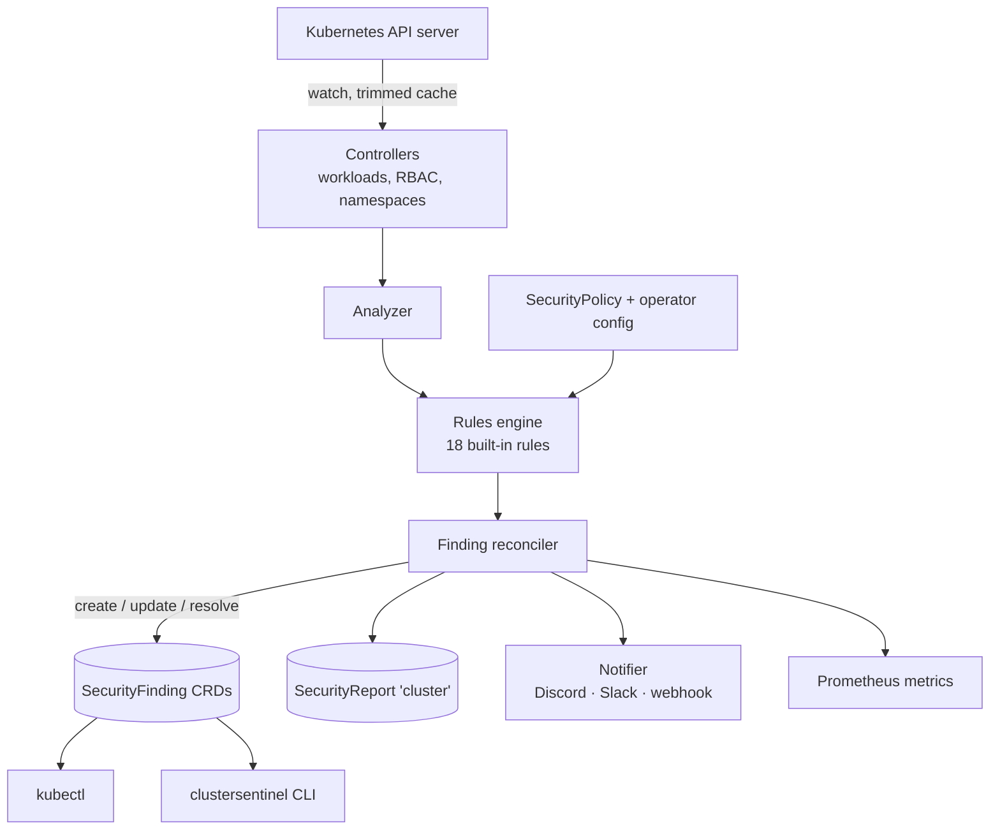

# Implementation plan

This is the working plan for the ClusterSentinel MVP. It records the decisions taken, the
assumptions made where the requirements were ambiguous, and the status of each phase.

## Status

| Phase | Scope | Status |
| --- | --- | --- |
| 1. Bootstrap | Go module, Kubebuilder project, CRD types, manager, Dockerfile, kind workflow, RBAC contract | **Done** |
| 2. Workload scanning | Workload controllers, analyzer, the 18 rules, unit tests | Next |
| 3. Findings | Finding reconciliation, deduplication, resolution, retention | Planned |
| 4. Configuration | SecurityPolicy profiles, overrides, namespace filtering | Planned (config schema done) |
| 5. CLI | `summary`, `findings`, `describe`, `report`, `fix`, `rules`, `version` | Planned |
| 6. Notifications and metrics | Discord, Slack, generic webhook; Prometheus metrics | Planned |
| 7. Helm and release | Chart, CI/CD, security scanning, documentation | Planned |

## Architecture

One Deployment with one replica (leader election stays on so a rolling update never runs
two active scanners). No node agent, no DaemonSet, no host access, no database: CRDs are
the source of truth.

## Keeping it light

The real costs of an operator like this are the memory of the informer cache and the
number of writes to the API server (and so etcd). The rule engine itself only compares
fields and is cheap.

| Measure | Where | Status |
| --- | --- | --- |
| Drop `managedFields` and `last-applied-configuration` from every cached object | `internal/manager/cache.go` | Done |
| Pods controlled by a ReplicaSet, StatefulSet, DaemonSet or Job keep only metadata in the cache; their template is analyzed instead | `internal/manager/cache.go` | Done |
| Secrets and ConfigMaps are never cached (and Secrets are never listed) | `internal/manager/cache.go`, RBAC | Done |
| `namespaces.include` limits the cache to those namespaces (plus the operator's own) | `internal/manager/cache.go` | Done |
| `namespaces.exclude` applied server-side as a field selector on namespaced watches | Phase 2 | Planned |
| Go soft memory limit = 90% of the container limit | `internal/manager/memory.go` | Done |
| Client QPS 10 / burst 20, at most 2 concurrent reconciles per controller | `cmd/main.go`, config | Done |
| Reconcile only on `metadata.generation` changes (status churn ignored) | Phase 2 | Planned |
| Hash of the security-relevant template fields + policy generation; unchanged → no analysis, no writes | Phase 2–3 | Planned |
| Periodic rescan reads from the cache, default every 30 minutes, `0` disables it | Phase 2 | Planned (config done) |
| `lastDetectedAt` refreshed at most once per rescan interval | Phase 3 | Planned |
| Findings carry an ownerReference to their workload, so Kubernetes deletes them with it | Phase 3 | Planned |
| Resolved findings deleted after `resolvedRetention` (default 7 days) | Phase 3 | Planned |
| Notifications from the initial scan sent as one digest, later ones batched | Phase 6 | Planned |
| One cluster SecurityReport, updated at most once a minute | Phase 3 | Planned |

Starting resources: requests 25m CPU / 64Mi, limits 200m CPU / 128Mi. These are targets
to be measured, not guarantees. Measured so far (Phase 1, no controllers yet, kind):
about 26 MB RSS and 7 MB heap at idle. Clusters with thousands of Pods will probably need
a 256Mi limit; sizing guidance will be published after Phase 2 with measurements.

## CRDs

All in `security.clustersentinel.io/v1alpha1`, namespaced. Schemas live in
`api/v1alpha1/` and are validated by `api/v1alpha1/crd_validation_test.go` against a
real API server.

**SecurityPolicy** (`secpol`): per-namespace profile (`basic`, `recommended`, `strict`,
`custom`) plus per-rule `enabled` / `severity` overrides keyed by rule key
(`privilegedContainer`, `runAsRoot`, …). `remediation.mode` only accepts `manual`.

**SecurityFinding** (`secf`): one rule violation on one resource (and container).
`spec` holds rule ID and version, effective severity, the affected resource including its
UID, title, description, evidence path, recommendation and documentation link. `status`
holds the lifecycle (`Open` / `Resolved`, first/last detected, resolved at) and the last
notified severity and state, so notification deduplication survives restarts.

**SecurityReport** (`secr`): exactly one, named `cluster`, in the operator's namespace.
Counts per severity, scanned resources, last scan time and a `ScannerHealthy` condition.
It does not copy findings. Per-namespace summaries are computed by the CLI from findings.

### Finding identity

`name = <kind>-<resource name, truncated>-<rule id>-<8 hex of sha256(uid, ruleID, container)>`,
plus labels for rule ID, severity, state, resource kind and resource UID. The UID in the
hash means a deleted and recreated workload never inherits old findings. The hash makes
the name deterministic, so repeated scans update instead of duplicating.

### Policy precedence

1. A SecurityPolicy in the workload's namespace. If there are several, the oldest
   (creationTimestamp, then name) wins and the others report `Active=False`.
2. Otherwise the operator-wide defaults from Helm values (`scanner.profile`, `scanner.rules`).

RBAC rules (`CS-RBAC-*`) are configured operator-wide only, because ClusterRoles and
ClusterRoleBindings have no namespace. Findings about cluster-scoped objects are stored in
the operator's namespace.

## Rules

The catalog is in `internal/rules/catalog.go`. Default severities are deliberately
moderate: missing hardening is not the same as an exploitable vulnerability.

| ID | Key | Default | Profiles |
| --- | --- | --- | --- |
| CS-CONTAINER-001 | privilegedContainer | CRITICAL | basic+ |
| CS-CONTAINER-002 | allowPrivilegeEscalation | HIGH | basic+ |
| CS-CONTAINER-003 | runAsRoot | MEDIUM | recommended+ |
| CS-CONTAINER-004 | readOnlyRootFilesystem | LOW | recommended+ |
| CS-CONTAINER-005 | dropCapabilities | LOW | recommended+ |
| CS-CONTAINER-006 | dangerousCapabilities | HIGH | basic+ |
| CS-CONTAINER-007 | seccompProfile | LOW | recommended+ |
| CS-CONTAINER-008 | hostNetwork | HIGH | basic+ |
| CS-CONTAINER-009 | hostPID | HIGH | basic+ |
| CS-CONTAINER-010 | hostIPC | HIGH | basic+ |
| CS-IMAGE-001 | latestImageTag | MEDIUM | recommended+ |
| CS-IMAGE-002 | implicitImageTag | MEDIUM | recommended+ |
| CS-SA-001 | serviceAccountToken | LOW | recommended+ |
| CS-SA-002 | defaultServiceAccount | INFO | strict |
| CS-RBAC-001 | wildcardRBAC | HIGH | recommended+ |
| CS-RBAC-002 | clusterAdminBinding | HIGH | basic+ |
| CS-RBAC-003 | broadRBAC | MEDIUM | recommended+ |
| CS-NETWORK-001 | missingNetworkPolicy | LOW | strict |

Profiles are nested: basic ⊂ recommended ⊂ strict. `custom` enables nothing by itself;
only rules explicitly enabled in the policy run.

## Pods and templates

- Deployment, StatefulSet, DaemonSet, CronJob: the pod template is analyzed once per
  workload, never per replica.
- Jobs created by a CronJob are skipped (the CronJob is analyzed); standalone Jobs are
  analyzed.
- Pods controlled by a ReplicaSet, StatefulSet, DaemonSet or Job are skipped.
- Every other Pod is analyzed itself: standalone Pods, static (mirror) Pods, and Pods of
  controllers ClusterSentinel does not know (Argo Rollouts, other operators). Grouping those
  by controller UID to avoid one finding per replica is part of Phase 2.
- Bare ReplicaSets (not owned by a Deployment) are a known gap until Phase 2 decides
  whether to watch ReplicaSets with a metadata-only cache.

## RBAC

The full ClusterRole is generated from `internal/manager/rbac.go` and checked by the e2e
test with `kubectl auth can-i`:

- `get`, `list`, `watch` on Deployments, StatefulSets, DaemonSets, Jobs, CronJobs, Pods,
  ServiceAccounts, Namespaces, Roles, RoleBindings, ClusterRoles, ClusterRoleBindings,
  NetworkPolicies.
- Read on SecurityPolicies; write on their status only.
- Full access to its own SecurityFindings and SecurityReports (delete is needed for
  retention).
- Leader election: `get`, `create`, `update` on Leases in its own namespace, and Events.
- **No access to Secrets cluster-wide.** The Helm chart will grant `get` on the
  notification Secrets by name, in the operator's namespace only.

A ClusterRole is required because workloads in every selected namespace and cluster-scoped
RBAC objects are watched. Verified by e2e: the operator cannot create, patch or delete
Deployments or Pods, cannot read Secrets, and cannot create ClusterRoleBindings.

## Notifications

A `Notifier` interface with one implementation per channel type: `discord`, `slack` and
`webhook` (a generic JSON POST). More types can be added without touching the finding
logic. Several channels can be active at once, each with its own Secret, minimum severity
and event selection (`newFinding`, `severityChanged`, `findingResolved`). Webhook URLs are
read from Secrets at send time, never cached, never logged and never written to CRDs.
Delivery: timeout, exponential backoff with jitter, and `Retry-After` honored. Deduplication
uses `status.notifiedSeverity` / `status.notifiedState` on each finding.

## Test strategy

| Level | Tool | Covers | Status |
| --- | --- | --- | --- |
| Unit | `go test` | Rule catalog, config validation, cache trimming, memory limit; later every rule (positive and negative), finding identity, notifier formatting and retry | Phase 1 parts done |
| API | envtest | CRD schema validation and defaults on a real API server | Done |
| Controller | envtest | Create / update / delete workloads, findings created, updated, resolved, no duplicates, namespace exclusion, policy changes, rescan | Phase 2–4 |
| End-to-end | kind | Deploy, pod hardening, metrics, RBAC least privilege; later the full insecure → finding → fixed → resolved workflow | Phase 1 parts done |
| Helm | `helm lint`, `helm template`, kubeconform | Chart validity, RBAC, security context | Phase 7 |

The kind targets and e2e tests use their own kubeconfig files in `bin/`, so they never read
or change `~/.kube/config` and cannot reach any cluster other than the local kind one.

## Risks

- **Cache memory on large clusters.** Mitigated by the trimming above; to be measured on a
  cluster with a few thousand Pods in Phase 2.
- **Write amplification.** Every status update is an etcd write. Mitigated by hashing,
  write-skipping and the coarse `lastDetectedAt`.
- **Finding volume.** A large cluster under the `strict` profile can produce thousands of
  findings. Mitigated by moderate default profiles, retention, and grouping by workload.
- **False positives.** Rules must look at both pod-level and container-level security
  contexts (container overrides pod), init and ephemeral containers, and image references
  with registries that have ports (`registry:5000/app`).
- **Notification floods.** A first install on a busy cluster must not send hundreds of
  messages; the initial scan is sent as a digest.

## Assumptions

- Module path `github.com/rikyrism/clustersentinel`; images at
  `ghcr.io/rikyrism/clustersentinel`. Replace if the repository lives elsewhere.
- Default rescan interval is 30 minutes (not 5): the informer already delivers every change,
  so the rescan is only a safety net.
- Helm rule keys use the same names as SecurityPolicy (`seccompProfile`, not
  `missingSeccomp`) so that one name means one rule everywhere.
- Metrics are served over plain HTTP on :8080 inside the cluster (they contain only
  aggregate counts); `--metrics-secure` enables HTTPS with Kubernetes authn/authz.
- Supported Kubernetes: built against client-go 0.37 (Kubernetes 1.37), tested with envtest
  1.37 and kind 1.34. Expected to work on 1.32 and newer; the minimum will be confirmed in CI.
